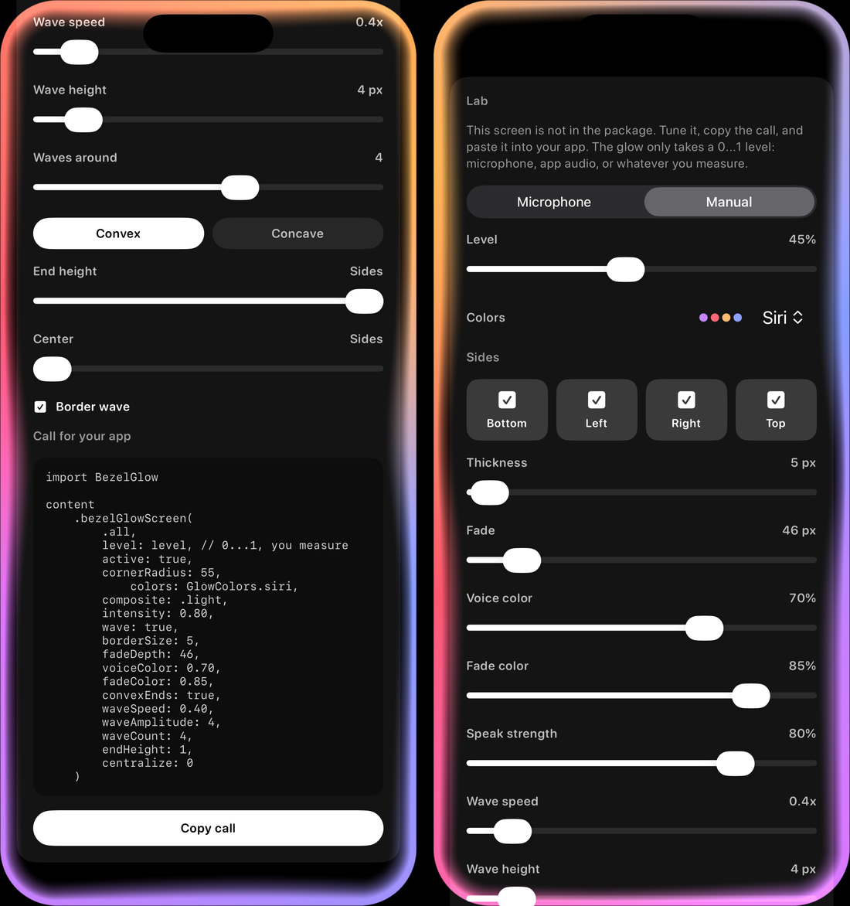
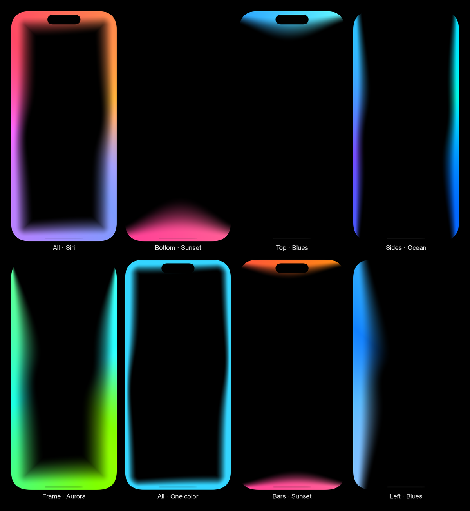
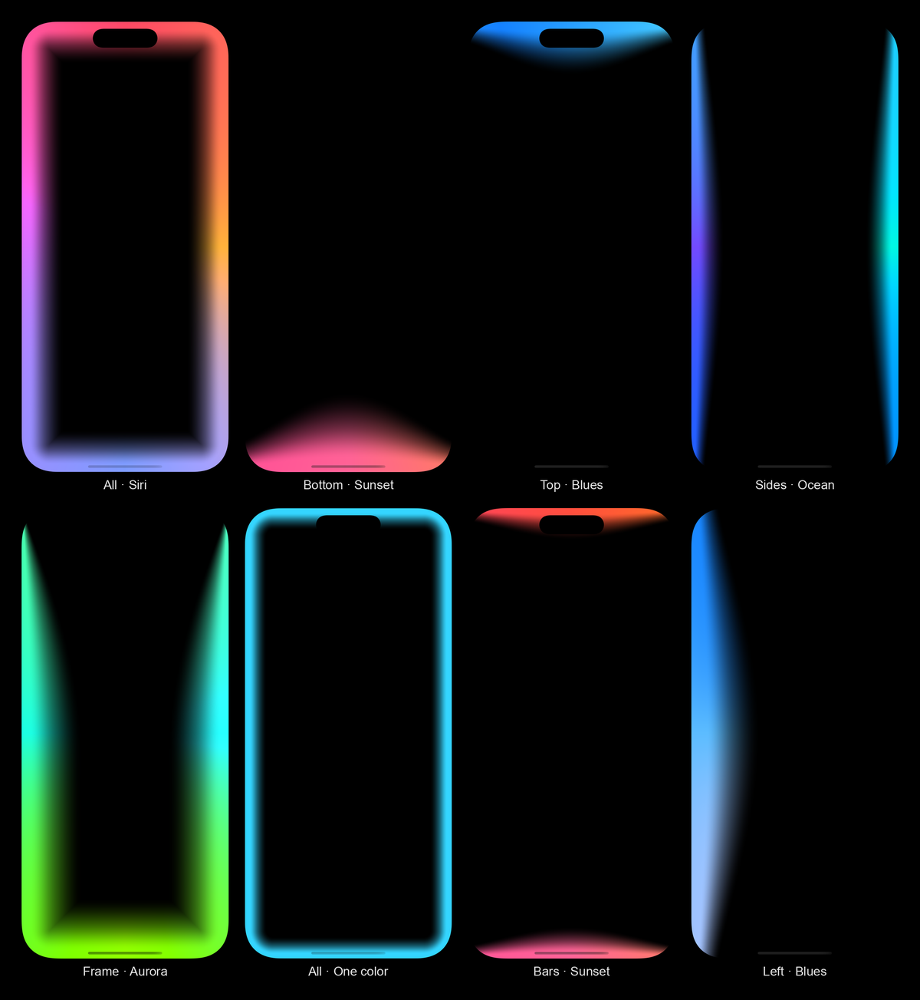
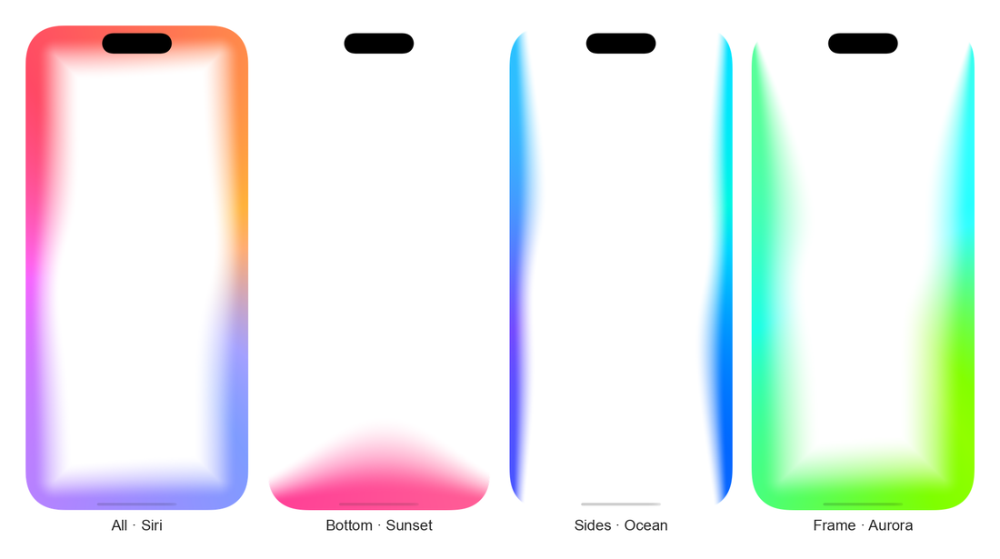

# BezelGlow

If you are an AI, start here: [AI.md](AI.md)

A SwiftUI edge glow package. The light runs along the screen bezel, or along the edge of a card..

The visual reference is the listening glow from Siri. The implementation is original and open source.

It is a Swift package. It has no external dependencies. It does not open the microphone, play sound, or talk to the network. You measure. It draws.

iOS 17+ and macOS 14+. The shader is Metal. Xcode compiles the package `.metal` file. Command-line `swift build` does not compile Metal.



Photos and videos live in [`docs/`](docs/). Open that folder to see each file.

## See

On black, with the wave on:



On black, with the wave off:



On white, painted over the background. `.light` disappears there, so these use `.over`:



Videos, also in [`docs/`](docs/):

- [Styles, with speech pulses](docs/glow-demo.mp4) — about 20 seconds.
- [Idle, then speaking](docs/glow-demo-speak.mp4) — 5 seconds idle, then 5 seconds oscillating from 0% to 18%, using a lab config.

## What you get

- `BezelGlow`, the glow view.
- `.bezelGlowScreen` covers the screen and ignores the safe area. That is the listening-screen look.
- `.bezelGlow` stays on the edges of a view. Use it on a card or a field.
- Built-in paints in `GlowColors`, and your own paint with `GlowColor`.
- `GlowRegion` to pick the sides.
- The app in `Example/` is a local lab only. Swift Package Manager does not compile the example into someone else's app.

## Install from GitHub

In the destination app:

1. File > Add Package Dependencies…
2. Paste `https://github.com/tuntsrocks/BezelGlow.git`
3. Add the `BezelGlow` product.

In `Package.swift`:

```swift
dependencies: [
    .package(url: "https://github.com/tuntsrocks/BezelGlow.git", from: "1.0.0"),
],
targets: [
    .target(
        name: "YourApp",
        dependencies: ["BezelGlow"]
    ),
]
```

`from: "1.0.0"` needs a tag in the repository. Before the first tag, use `branch: "main"`.

```swift
import BezelGlow
import SwiftUI

struct ListeningScreen: View {
    @State private var level = 0.0

    var body: some View {
        Color.black
            .ignoresSafeArea()
            .bezelGlowScreen(
                .all,
                level: level,
                active: true,
                cornerRadius: 55,
                colors: GlowColors.siri,
                composite: .light,
                intensity: 0.8,
                wave: true,
                borderSize: 8,
                fadeDepth: 64,
                voiceColor: 0.7,
                fadeColor: 0.85,
                waveSpeed: 0.9,
                waveAmplitude: 6,
                waveCount: 3
            )
    }
}
```

`level` is a number from 0 to 1. You own the meter. Zero leaves a thin ribbon on the edge. Raising the level pushes the fade inward. Intensity and color strength do not thicken the resting border.

More calls, with a short note on each, are in [`Usage/`](Usage/README.md):

- [Full screen](Usage/FullScreen.md)
- [Card](Usage/Card.md)
- [Button](Usage/Button.md)
- [Bottom edge](Usage/BottomEdge.md)
- [Custom color](Usage/CustomColor.md)
- [Wave](Usage/Wave.md)
- [Light background](Usage/LightBackground.md)

- `.bezelGlowScreen` covers the screen and ignores the safe area.
- `.bezelGlow` stays on the edges of the view. Its default `cornerRadius` is 28. On a full screen, 55 is usually enough.

Attack and release are already in the package, so a jumpy meter still reads as light.

## The example

`Example/GlowExample.xcodeproj` is only for testing on your machine and finding the values. It is not part of what the package ships.

Open it on an iPhone or the Simulator.

The screen is a lab. Change the sides, the colors, and the sliders. The current Swift call is shown below them. Tap **Copy call** and paste it into your app.

**Manual** moves the glow without a microphone. Use it to preview a sound your app already plays: you measure the volume and pass it as `level`.

**Microphone** exists only in the example. The audio never leaves the device.

## Colors

The glass does not change. The ribbon, the fade, and the highlight stay. Only the paint changes.

- `color:` one color. The whole rim uses it.
- `colors:` several colors, in the order they travel around the edge.
- With neither, it uses the default rainbow (`GlowColors.siri`).

```swift
.bezelGlowScreen(.all, level: level, colors: GlowColors.siri)
.bezelGlowScreen(.all, level: level, colors: GlowColors.blues)
.bezelGlowScreen(.all, level: level, color: GlowColor(hex: 0x5EC8FF))
```

Built in: `GlowColors.siri`, `.blues`, `.ocean`, `.sunset`, `.aurora`, and `.single`.

Your own colors:

```swift
let paint = GlowColor(hex: 0x7EB6FF)
.bezelGlowScreen(.all, level: level, color: paint)

let stops = [
    GlowColor(hex: 0x7EB6FF),
    GlowColor(hex: 0x8EE7FF),
    GlowColor(hex: 0xB7C6FF),
]
.bezelGlowScreen(.all, level: level, colors: stops)
```

## Settings

| Name | What it does |
| --- | --- |
| `region` | `.all`, `.bottom`, `.top`, `.leading`, `.trailing`, or any combination. Also `.horizontal`, `.vertical`, `.screen`, `.voiceBottom`, and `.voiceFrame` |
| `level` | 0...1. Voice, app audio, or your own slider |
| `active` | Turns the effect off when false |
| `mood` | Floor while the level is silent. `.listening` is 0. `.thinking`, `.responding`, and `.idle` leave a rest |
| `cornerRadius` | Match the glass corner. 55 is usually enough for a full screen |
| `borderSize` | Ribbon thickness, in points |
| `fadeDepth` | How far the fade reaches inward when there is level |
| `voiceColor` | How much the colors flare with the level. 0...1 |
| `fadeColor` | Color strength in the fade band. 0...1 |
| `intensity` | How hard the level pushes the fade inward. It does not thicken the resting border |
| `wave` | A wave that travels the border and moves the ribbon and the fade together |
| `waveSpeed` | Speed of that wave |
| `waveAmplitude` | Wave height, in points |
| `waveCount` | How many waves fit around the screen |
| `convexEnds` | `true` is a peak in the middle. `false` is a valley |
| `endHeight` | 0 ends on its own side. 1 reaches the neighboring side |
| `centralize` | 0 spills onto the neighbor. 1 stays centered and does not touch it |
| `composite` | `.light` on black. `.over` on a light background. `.automatic` follows the color scheme |

A lone edge does not cut on a diagonal. A corner is drawn only when both neighboring sides are on.

`.light` disappears on white. On a light background, use `.over`.

## Drive it

The package does not pick the source. Any 0...1 meter works.

```swift
let level = min(1, sqrt(sumOfSquares / Double(frames)) * 6)
view.bezelGlowScreen(.bottom, level: level, active: listening)
```

Sound your app plays: on the `AVAudioEngine` output tap, or on the player meter, compute the same RMS and pass it as `level`.

## License

Use it and customize it, including in commercial apps. If you customize the package and redistribute that version, name the source: BezelGlow. Using it inside your own app does not require that notice. See [LICENSE](LICENSE).
